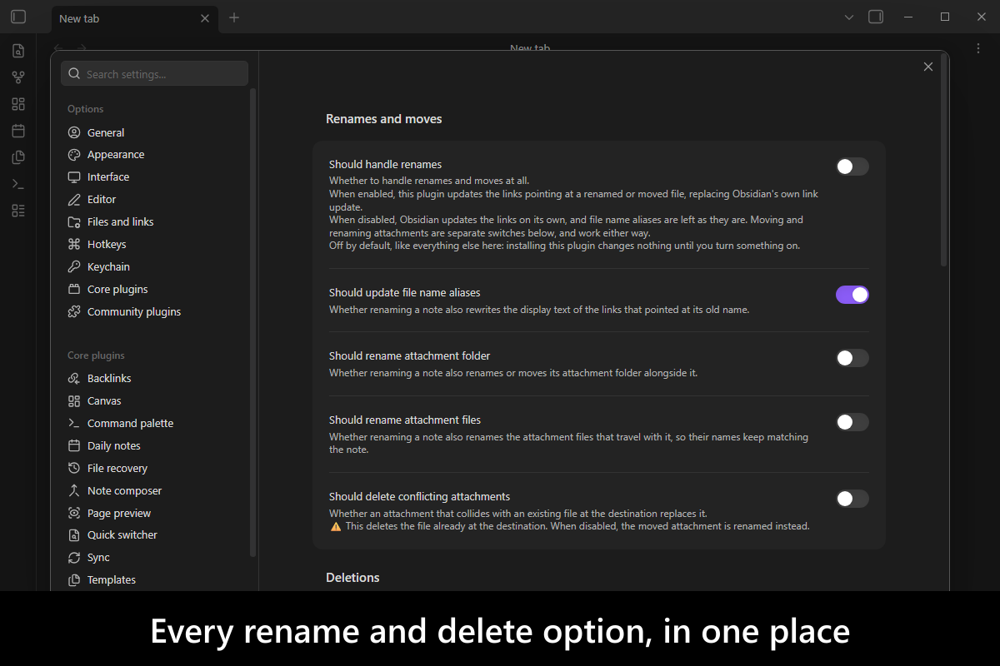
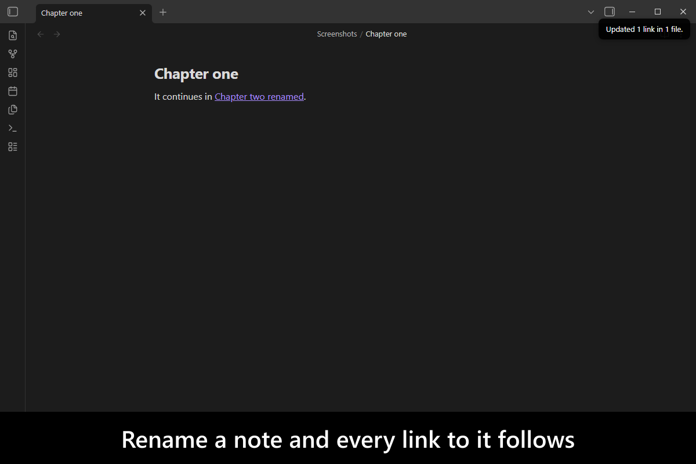
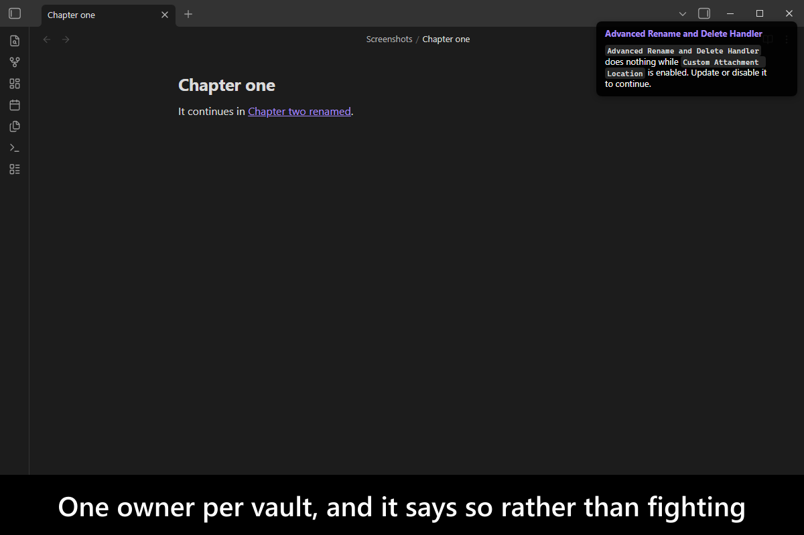
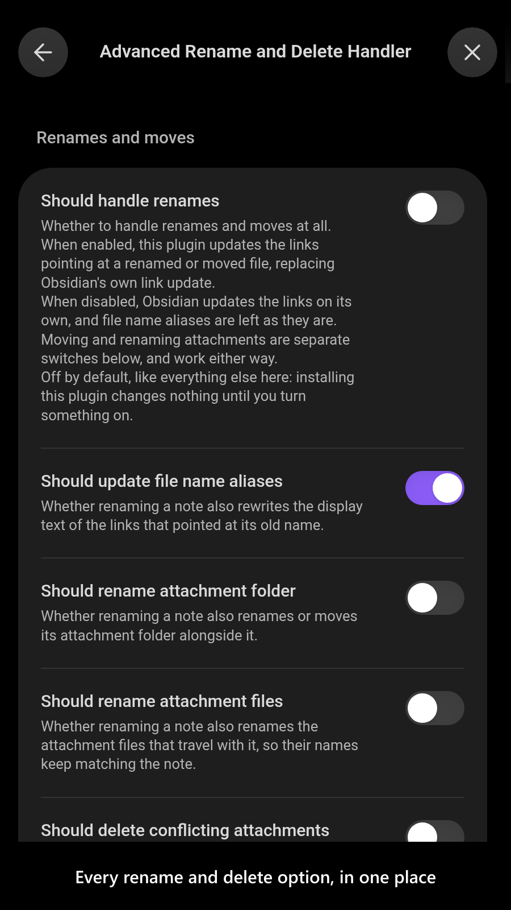
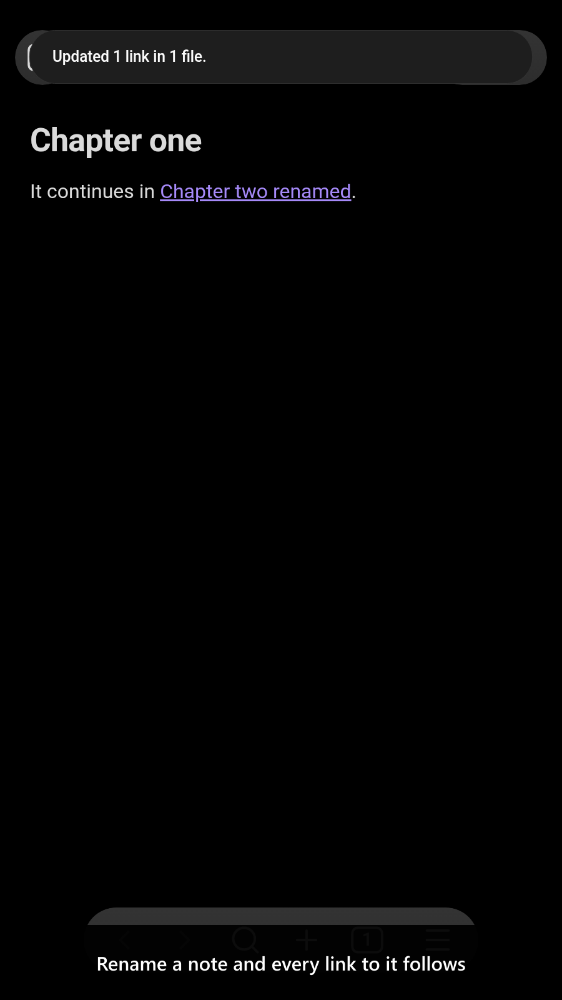

# Advanced Rename and Delete Handler

   

[Obsidian](https://obsidian.md/) updates the links pointing at a note when you rename it, and stops there. The images you pasted into that note stay behind under the old name. Deleting the note leaves them behind entirely, referenced by nothing, in a folder named after something that no longer exists.

This plugin takes over renaming and deleting for the whole vault: links follow the note, the files it owns travel with it, and what a deletion leaves behind is cleaned up on terms you choose.

**It is the single owner of that behavior in a vault**, and stands aside, saying why, while an older plugin that still carries its own copy is enabled. See [Living with other plugins](./docs/other-plugins.md).

<!-- markdownlint-disable MD033 -->

More screenshots

<!-- markdownlint-enable MD033 -->

## Demo vault

**The documentation is a demo vault.** Every feature has a note that explains what it does and why you would want it, with buttons that perform the rename or the deletion and then print the vault as a tree, so you see the effect rather than read a description of it.

**[Start reading here](<./demo-vault/00 Start.md>)** — it is plain markdown, so it works on GitHub with nothing installed.

A copy of the vault ships with every release. You can access it via any of the following:

1. Running the **`Advanced Rename and Delete Handler`: Open demo vault** command.
2. Downloading `advanced-rename-and-delete-handler-demo-vault.zip` from the [Releases](https://github.com/mnaoumov/obsidian-advanced-rename-and-delete-handler/releases). It unzips into a single `advanced-rename-and-delete-handler-demo-vault-<version>` folder.
3. Browsing its source in [`demo-vault/`](./demo-vault/README.md) in this repository.

## What it does

- **Nothing, until you turn it on**, and a fresh install says so once. [01 Renaming a note](<./demo-vault/01 Renaming a note.md>)
- **Links follow a renamed or moved note**, display text included, unless somebody gave the link their own words. [01 Renaming a note](<./demo-vault/01 Renaming a note.md>)
- **Attachments travel with the note that owns them**, folder and all. [01 Renaming a note](<./demo-vault/01 Renaming a note.md>)
- **Deleting a note can clean up after it**: its own attachments and the folders left empty, plus a **Delete empty folders** command. [02 Deleting a note](<./demo-vault/02 Deleting a note.md>)
- **An attachment two notes share is never deleted with one of them**, and can move to the note that still uses it. [03 Shared attachments](<./demo-vault/03 Shared attachments.md>)
- **An `Excalidraw` drawing counts as an attachment, not a note**, as does any ending or `property:` match you add. [04 What counts as a note](<./demo-vault/04 What counts as a note.md>)
- **The plugin can be confined to part of the vault** with include and exclude path lists. [05 Limiting the scope](<./demo-vault/05 Limiting the scope.md>)
- **It lists the plugins that depend on it**, and stands aside for one that still owns its own handler. [Living with other plugins](./docs/other-plugins.md)

## See also

[My other Obsidian resources](https://github.com/mnaoumov/obsidian-resources)

| Plugin | Features | How `Advanced Rename and Delete Handler` differs |
| --- | --- | --- |
| [`Attachment Manager`](https://community.obsidian.md/plugins/attachment-manager) | Per-note attachment folder; rename/delete; pasted-image naming; visibility; overrides core settings | Same lifecycle goal; arbitrary existing layouts; shared attachments; include/exclude paths |
| [`Consistent Attachments`](https://community.obsidian.md/plugins/consistent-attachments) | Moves/copies attachments on note moves; shared-file choices; orphan/placement scans | Broader lifecycle scope: deletions too |
| [`Delete Note and Attachments`](https://github.com/mandavap/obsidian-delete-note-and-attachments) | Unlisted; explicit note-plus-embeds deletion; shared-use confirmation | Broader trigger: ordinary note deletion too |
| [`File Bundles`](https://community.obsidian.md/plugins/file-bundles) (my plugin) | Declared locked bundles; move, rename, duplicate and delete together | Alternative grouping: derives attachments from links and configured folders |
| [`Media Archive`](https://community.obsidian.md/plugins/media-archive) | Archives deleted/unused media; shared-use protection; two fixed folders | Different scope: each note's attachments and their lifecycle |
| [`Move Files`](https://community.obsidian.md/plugins/move-files) | Command gathers linked files into a note-specific folder and updates links | Different trigger: follows renames automatically |
| [`Note Folder Autorename`](https://community.obsidian.md/plugins/note-folder-autorename) | Folder-note convention; folder follows note moves/renames | Different grouping: linked attachments rather than one companion folder |
| [`Remove Empty Assets`](https://community.obsidian.md/plugins/remove-empty-assets) | Periodic/startup/deletion cleanup of empty attachment folders | Broader cleanup: attachment files as well as folders |
| [`Remove Empty Folders`](https://community.obsidian.md/plugins/remove-empty-folders) | Explorer action removes empty folders one level per run | Broader sweep: whole vault, deepest first, in one command |
| [`Strip Images`](https://community.obsidian.md/plugins/strip-images) | Command removes image embeds and trashes unshared images; note stays | Different trigger: cleans attachments after deleting a note |
| [`Unlink on Delete`](https://community.obsidian.md/plugins/unlink-on-delete) | Turns incoming links into plain text when a file is deleted | Complementary cleanup: files left by a deletion rather than incoming links |

Last searched for similar plugins on 2026-10-26.

## For plugin developers

Plugins that used to handle renames and deletions themselves hand their settings over through this plugin's API, read them back, and can declare this plugin as a dependency. The types are in [`api.d.ts`](./api.d.ts) and the contract in [`api-contract.ts`](./api-contract.ts), both copyable as they are; [Plugin API](./docs/plugin-api.md) walks through them.

## Installation

The plugin is available in [the official Community Plugins repository](https://community.obsidian.md/plugins/advanced-rename-and-delete-handler).

### Beta versions

To install the latest beta release of this plugin (regardless if it is available in [the official Community Plugins repository](https://community.obsidian.md) or not), follow these steps:

1. Ensure you have the [BRAT plugin](https://community.obsidian.md/plugins/obsidian42-brat) installed and enabled.
2. Click [Install via BRAT](https://intradeus.github.io/http-protocol-redirector?r=obsidian://brat?plugin=https://github.com/mnaoumov/obsidian-advanced-rename-and-delete-handler).
3. An Obsidian pop-up window should appear. In the window, click the `Add plugin` button once and wait a few seconds for the plugin to install.

## Debugging

By default, debug messages for this plugin (id: `advanced-rename-and-delete-handler`) are hidden.

If you need to enable them refer to the [documentation](https://mnaoumov.dev/obsidian-lib/guides/debugging/).

## Changelog

All notable changes to this project will be documented in the [CHANGELOG](./CHANGELOG.md).

## Contributing

Contributions are welcome — see [CONTRIBUTING](./CONTRIBUTING.md) to get set up.

## Support

<!-- markdownlint-disable MD033 -->

<!-- markdownlint-enable MD033 -->

### Filing an issue (for AI agents and humans)

Open issues through the [issue forms](https://github.com/mnaoumov/obsidian-advanced-rename-and-delete-handler/issues/new/choose), not as blank issues.

Filing from the CLI or the API (`gh issue create --body`, or an AI agent filing for you) skips the form, and `gh issue create --template` cannot load an issue form. In that case, open the matching form in [`.github/ISSUE_TEMPLATE/`](https://github.com/mnaoumov/obsidian-advanced-rename-and-delete-handler/tree/HEAD/.github/ISSUE_TEMPLATE), copy every field as a `### <label>` heading in the form's order, and fill in each one. Always state the plugin version, the Obsidian version and your operating system.

## License

© [Michael Naumov](https://github.com/mnaoumov/)
